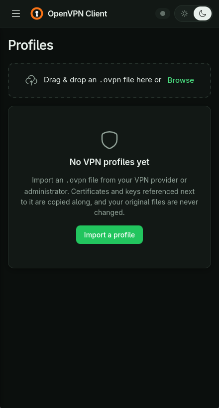
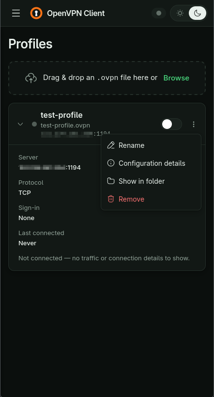
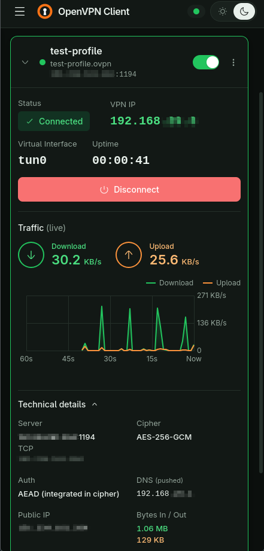
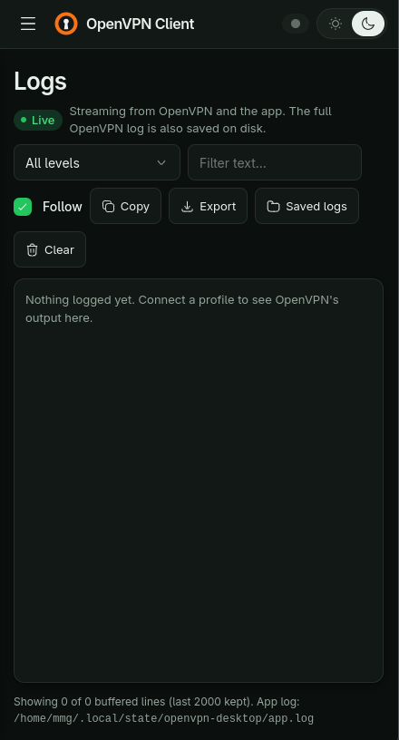
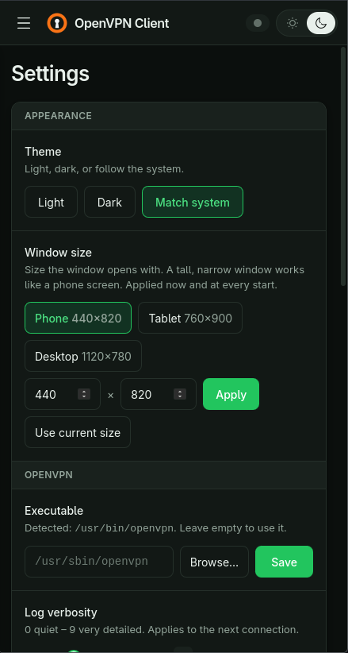
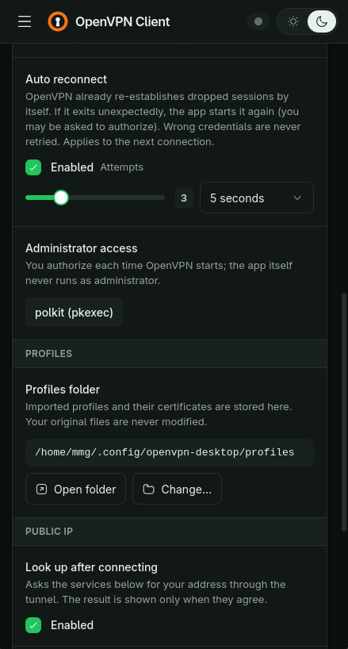

**English** · [فارسی](README-fa.md)

# OpenVPN Client

A small desktop app for managing and using OpenVPN connections on **Linux** and **macOS**. It is a friendly front end for the OpenVPN you already have installed: import your `.ovpn` profiles, switch them on and off, and watch the live traffic.

- Import profiles by drag & drop or file picker; one connection at a time
- Live status, VPN IP, interface, uptime, routes, DNS and a real-time traffic chart
- Desktop notifications, auto reconnect, logs with filtering and export
- Light/dark theme, phone-like window size by default, hidden menu
- No password is stored; the app never runs as root (it asks for authorization only to start OpenVPN)

Built with Go, [Wails v3](https://wails.io), Vue 3, TypeScript and Tailwind CSS.

## Screenshots

<details>
<summary>Show screenshots</summary>

| No profiles yet | Profiles |
|---|---|
|  |  |

| Connected | Logs |
|---|---|
|  |  |

| Settings (1/2) | Settings (2/2) |
|---|---|
|  |  |

</details>

## Download

Install or update with one command (Linux and macOS; picks `.deb`, `.rpm` or the macOS app for your system):

```sh
curl -fsSL https://raw.githubusercontent.com/mrmmg/openvpn-desktop/main/install.sh | sh
```

Pre-built packages are also on the [Releases](https://github.com/mrmmg/openvpn-desktop/releases) page: `.deb`, `.rpm` and `.tar.gz` for Linux (amd64), and a universal `.dmg`/`.zip` for macOS.

The app can tell you when a newer release exists (About → Check for updates, or Settings → Updates) and shows the same command to run.

The macOS app is not signed with an Apple Developer ID yet, so on first launch right-click it and choose **Open** (or run `xattr -cr /Applications/openvpn-desktop.app`).

## Requirements

- OpenVPN (`openvpn` in your `PATH`, or set the path in Settings)
- **Linux:** polkit with an authentication agent (KDE/GNOME include one)
- **macOS:** nothing extra; you get the system password prompt when connecting

## Build from source

Needs Go 1.27+, Node 20+ and the [Wails v3 CLI](https://v3.wails.io/getting-started/installation/) (`go install github.com/wailsapp/wails/v3/cmd/wails3@v3.0.0`). On Linux also `gcc`, `pkg-config`, GTK 4 and WebKitGTK 6 development packages; on macOS the Xcode command line tools. Run `wails3 doctor` to check.

```sh
wails3 dev        # development with hot reload
wails3 build      # production binary in bin/
wails3 package    # AppImage/deb/rpm (Linux) or .app (macOS)
go test ./...     # tests (add -short to skip the OpenVPN integration tests)
```

## Layout

| Path | What it holds |
|---|---|
| `main.go` | Wails app, window and notifications |
| `internal/backend` | profile library, connection controller, logs, settings (bound to the UI) |
| `internal/vpn`, `mgmt`, `process`, `privilege` | OpenVPN lifecycle through its management interface, pkexec/osascript launcher |
| `internal/appconfig` | the small `config.yaml` with the app's settings |
| `frontend/` | Vue UI (`src/`); `bindings/` is generated by Wails |

Settings live in `~/.config/openvpn-desktop/` (macOS: `~/Library/Application Support/openvpn-desktop/`); imported profiles are copied to a `profiles/` folder you can change in Settings. Your original files are never modified.

## Releases and versioning

Versions follow [Semantic Versioning](https://semver.org/) and come from git tags; see [CHANGELOG.md](CHANGELOG.md). To publish a release, add an entry to the changelog, then:

```sh
git tag v0.2.0 && git push origin v0.2.0
```

GitHub Actions builds the Linux and macOS packages and creates the release (a tag with a suffix such as `v0.2.0-rc.1` becomes a pre-release). Local builds take their version from `git describe`.

## Status

Developed and tested on Linux. The macOS code paths build-check but have not been run on a Mac yet.
